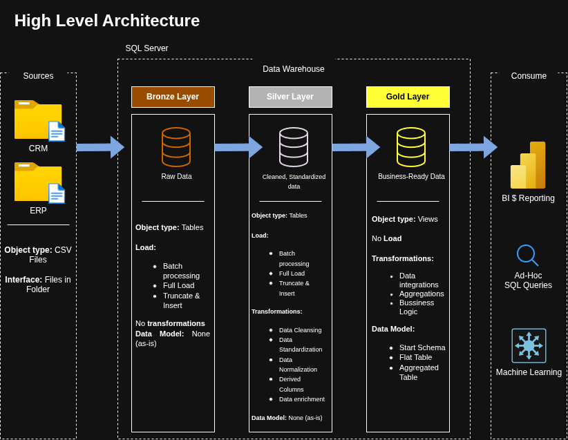
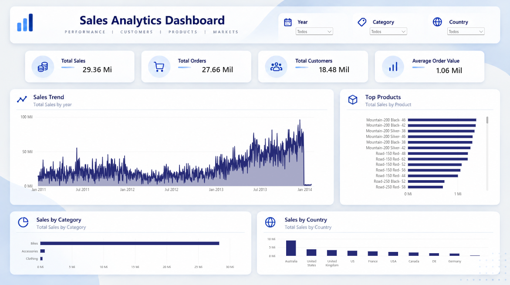

# SQL Data Warehouse & Analytics Project

A modern **Data Warehouse and Analytics** project built with **SQL Server and Power BI**, covering the complete data engineering workflow from raw data ingestion to analytical modeling, business intelligence, and interactive reporting.

This project was originally developed as part of the **Data With Baraa SQL Data Warehouse course** and was later **refactored, reorganized, documented, and extended by Felipe Feitosa Teixeira** as part of my Data Engineering learning journey and professional portfolio.

The original data warehouse was extended with a **Power BI analytical layer**, consuming the Gold dimensional model to create an interactive sales dashboard.

---

## Project Overview

The goal of this project is to design and implement a modern data warehouse that consolidates data from multiple source systems and prepares it for analytical workloads.

The solution follows the **Medallion Architecture**, separating the data pipeline into three layers:

- **Bronze** — raw data ingestion
- **Silver** — data cleansing, standardization, and transformation
- **Gold** — business-ready dimensional models for analytics

The Gold layer is then consumed by **Power BI**, providing an interactive analytical dashboard built directly on top of the dimensional model.

The project demonstrates practical concepts commonly used in Data Engineering and Business Intelligence, including:

- ETL pipeline development
- Data cleansing and transformation
- Data integration
- Dimensional data modeling
- Star schema design
- Data quality validation
- SQL analytics
- Data warehouse architecture
- Business Intelligence
- Power BI semantic modeling
- DAX measures
- Interactive dashboards
- Technical documentation

---

## Data Architecture

The architecture follows the **Bronze, Silver, and Gold** layers of the Medallion Architecture.



### Bronze Layer

The Bronze layer stores the source data in its original format.

Data from the ERP and CRM systems is provided through CSV files and loaded into SQL Server with minimal transformation.

### Silver Layer

The Silver layer is responsible for preparing the data for downstream analytical use.

This stage includes:

- Data cleansing
- Standardization
- Normalization
- Duplicate handling
- Data type validation
- Business-rule transformations
- Integration between ERP and CRM datasets

### Gold Layer

The Gold layer contains business-ready datasets designed for analytics and reporting.

The data is modeled using a **Star Schema**, with fact and dimension views optimized for analytical queries and BI workloads.

The Gold layer contains the analytical structures consumed by Power BI:

- `gold.dim_customers`
- `gold.dim_products`
- `gold.fact_sales`

These objects form the semantic foundation of the dashboard.

---

## ETL & Analytics Pipeline

The project implements an ETL workflow that moves data through the three warehouse layers and ultimately exposes the analytical model to Power BI.

```text
CSV Sources
    |
    v
Bronze Layer
Raw ingestion
    |
    v
Silver Layer
Cleaning + Transformation + Integration
    |
    v
Gold Layer
Star Schema / Analytical Model
    |
    +-------------------+
    |                   |
    v                   v
SQL Analytics       Power BI
                    Semantic Model
                        |
                        v
                    DAX Measures
                        |
                        v
                Interactive Dashboard
```

The pipeline integrates information from two source systems:

- **CRM**
  - Customers
  - Products
  - Sales transactions

- **ERP**
  - Customer demographics
  - Customer locations
  - Product categories

---

## Project Requirements

### Data Engineering

The main objective is to build a modern SQL Server data warehouse capable of consolidating sales information from multiple systems.

The implementation includes:

- Importing ERP and CRM datasets from CSV files
- Cleaning and validating source data
- Resolving data quality issues
- Integrating information from different systems
- Building analytical fact and dimension tables
- Creating reusable SQL scripts for each warehouse layer
- Performing data quality validation
- Documenting the architecture and data model
- Exposing the Gold layer for downstream BI consumption

The project focuses on the latest available dataset and does not implement historical tracking.

---

## Analytics

The Gold layer supports both **SQL-based analysis** and **Power BI reporting**, focused on three main business areas.

### Customer Behavior

Analysis of customer characteristics, geographic distribution, and purchasing behavior.

### Product Performance

Evaluation of products, categories, sales contribution, and product-level performance.

### Sales Trends

Analysis of sales performance and trends over time.

These analytical models make it possible to generate business metrics, identify patterns, and support data-driven decision-making.

---

## Power BI Dashboard

As an extension of the original Data Warehouse project, an interactive **Power BI dashboard** was developed using the Gold layer as its analytical source.

The Power BI model consumes:

- `gold.dim_customers`
- `gold.dim_products`
- `gold.fact_sales`

A dedicated date dimension was also created inside Power BI to support time-based analysis.

The dimensional relationships follow the same **Star Schema** designed in the SQL Data Warehouse.

### Dashboard Overview

The dashboard provides a high-level view of sales performance through:

- Total Sales
- Total Orders
- Total Customers
- Average Order Value
- Sales trends over time
- Sales by product category
- Top-performing products
- Sales distribution by country
- Interactive filters for year, category, and country

The report uses reusable **DAX measures** and an interactive semantic model built on top of the Gold layer.

### Live Power BI Demo

The interactive dashboard is publicly available through Power BI Service:

**[View the Live Power BI Dashboard](https://app.powerbi.com/view?r=eyJrIjoiOGFkNjQ2ZDctOWE3Ni00MGI2LWJmYWMtYmJiOTZhNzRlYTU3IiwidCI6ImQzOGYwZDk4LWNhZjMtNDMwOS04YzY3LTllNGViNzY3ZTkwYyJ9)**

### Dashboard Preview



This BI layer extends the project from a traditional Data Warehouse implementation into a complete analytical workflow:

```text
Source Systems
      |
      v
Bronze
      |
      v
Silver
      |
      v
Gold
      |
      v
Star Schema
      |
      v
Power BI Semantic Model
      |
      v
DAX Measures
      |
      v
Interactive Dashboard
```

---

## Data Modeling

The analytical layer uses dimensional modeling based on a **Star Schema**.

The Gold layer contains:

- Sales fact data
- Customer dimension
- Product dimension
- Date-related attributes
- Business-ready analytical fields


The model follows a one-to-many relationship pattern:

```text
dim_customers
      1
      |
      *
  fact_sales
      *
      |
      1
dim_products
```

Inside Power BI, an additional Date dimension supports time intelligence and filtering based on `order_date`.

This structure simplifies analytical queries and improves readability and performance for BI and reporting workloads.

---

## Data Flow

The complete flow of data through the project is documented below:


Additional documentation is available in the `docs/` directory.

---

## Technologies

The main technologies and tools used in this project are:

- **SQL**
- **Microsoft SQL Server**
- **SQL Server Management Studio (SSMS)**
- **Power BI Desktop**
- **Power BI Service**
- **DAX**
- **ETL**
- **Dimensional Modeling**
- **Star Schema**
- **Medallion Architecture**
- **Draw.io**
- **Docker**
- **Git**
- **GitHub**

---

## Repository Structure

```text
data-warehouse-project/
│
├── datasets/
│   ├── source_crm/
│   └── source_erp/
│
├── docs/
│   ├── requirements.md
│   ├── data_architecture.png
│   ├── data_flow.png
│   ├── data_integration.png
│   ├── data_model.png
│   ├── powerbi_dashboard.png
│   ├── ETL.png
│   ├── data_catalog.md
│   ├── naming_conventions.md
│   ├── data_layers.pdf
│   └── Project_Notes_Sketches.pdf
│
├── scripts/
│   ├── init_database.sql
│   ├── bronze/
│   ├── silver/
│   └── gold/
│
├── tests/
│
├── README.md
├── LICENSE
└── .gitignore
```

---

## Documentation

The `docs/` directory contains supporting documentation for the project, including:

- Data architecture
- Data flow
- Data integration
- ETL design
- Dimensional model
- Power BI dashboard preview
- Data catalog
- Naming conventions
- Project requirements

For the detailed project requirements, see:

[`docs/requirements.md`](docs/requirements.md)

---

## Running the Project

### 1. Clone the repository

```bash
git clone https://github.com/felipeft/sql-data-warehouse-project.git
cd sql-data-warehouse-project
```

### 2. Install SQL Server

The project uses **Microsoft SQL Server** as the database engine.

SQL Server Developer or Express can be used for local development.

### 3. Open SQL Server Management Studio

Connect to your SQL Server instance using SSMS.

### 4. Initialize the Database

Run:

```text
scripts/init_database.sql
```

This creates the database structure and the Bronze, Silver, and Gold schemas.

### 5. Load the Bronze Layer

Execute the scripts inside:

```text
scripts/bronze/
```

These scripts ingest the raw CSV datasets.

### 6. Build the Silver Layer

Execute the scripts inside:

```text
scripts/silver/
```

These scripts clean, standardize, validate, and integrate the source data.

### 7. Build the Gold Layer

Execute the scripts inside:

```text
scripts/gold/
```

These scripts create the analytical fact and dimension models.

### 8. Run Data Quality Tests

Use the scripts available in:

```text
tests/
```

to validate the Silver and Gold layers.

### 9. Connect Power BI

The Power BI report consumes the Gold analytical layer directly from SQL Server.

The main analytical objects are:

```text
gold.dim_customers
gold.dim_products
gold.fact_sales
```

The resulting semantic model can then be used to build DAX measures, reports, and interactive dashboards.

---

## Key Concepts Practiced

This project was used to strengthen practical knowledge in:

- SQL development
- Data Engineering
- Data Warehouse design
- ETL pipelines
- Data quality
- Data integration
- Dimensional modeling
- Star schema
- Analytical SQL
- Business Intelligence
- Power BI
- Semantic modeling
- DAX
- Data visualization
- Dashboard design
- Data documentation
- Git and version control

---

## Project Origin

This repository is based on the **SQL Data Warehouse Project** taught by **Baraa Khatib Salkini — Data With Baraa**.

The original educational project provided the initial architecture, datasets, and learning workflow.

This version was completed and refactored for study and portfolio purposes, with adjustments to project organization, documentation, implementation, presentation, and an additional **Power BI analytical layer developed as an extension of the original project**.

Original project:

https://github.com/DataWithBaraa/sql-data-warehouse-project

---

## About Me

I'm **Felipe Feitosa Teixeira**, a Computer Engineer focused on **Data Engineering**, backend development, and data-driven systems.

I use projects like this to develop practical experience with data pipelines, SQL, data modeling, analytics, Business Intelligence, and modern Data Engineering architectures.

### Connect with Me

[](https://www.linkedin.com/in/felipe-ft)

[](https://felipeft.github.io/)

---

## License

This project is licensed under the [MIT License](LICENSE).

The educational foundation of this project belongs to its original author and course. This repository represents my implementation, refactoring, documentation, and analytical extension of the project for learning and portfolio purposes.